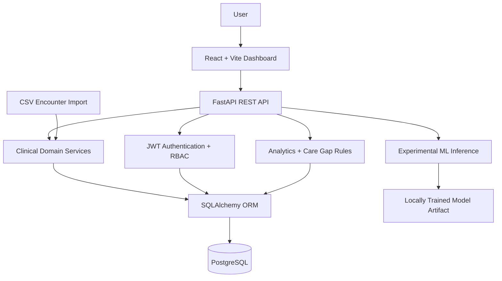

# CareGap-AI

**Full-Stack Healthcare Analytics & Care Gap Detection Platform**

CareGap-AI is a portfolio-grade healthcare analytics MVP that brings patient and encounter management, rule-based care-gap detection, organization-scoped workflows, and experimental machine-learning inference into one full-stack application.

Built with **FastAPI, React, PostgreSQL, SQLAlchemy, and scikit-learn**, it demonstrates backend API design, relational data modeling, access control, clinical-data ingestion, applied ML, and automated testing.

> **Status:** Functional MVP / engineering demonstration. **Not a clinical decision-support product.** The readmission model is trained on synthetic data and must not be used for diagnosis, treatment, or patient-care decisions.

## At a glance

| Area | Implementation |
| --- | --- |
| Backend | Python, FastAPI, Pydantic, SQLAlchemy |
| Frontend | React, Vite, JavaScript, Tailwind CSS |
| Database | PostgreSQL with Alembic migrations |
| Authentication | JWT and role-based access control (RBAC) |
| Analytics | Encounter metrics and rule-based care-gap checks |
| Machine learning | Experimental scikit-learn logistic regression |
| Validation | **159 passing backend tests**; successful Vite production build |
| API documentation | FastAPI-generated OpenAPI / Swagger UI |

## Product walkthrough

The following screenshots show the main application workflows using synthetic demonstration data:

| Dashboard overview | Care-gap review |
| --- | --- |
|  |  |

| Patient records | Clinical encounters |
| --- | --- |
|  |  |

| Experimental readmission-risk interface |
| --- |
|  |

**Suggested demo:** Sign in → select an organization → view patients and encounters → import sample encounters → inspect analytics and detected care gaps → explore the experimental readmission-risk interface.

> Screenshots use synthetic demonstration data. The workflow above describes the intended demonstration, not an independently verified end-to-end recording.

## Features

### Identity and organization management

- User registration and JWT-based login.
- Organization creation, membership management, and role-based access controls.
- Protected endpoints and audit logging for supported operations.

### Patients and encounters

- Create, retrieve, and update patient records.
- Manage clinical encounters with validated, structured inputs.
- Organization-scoped API workflows.

### Clinical data imports

- CSV encounter imports with validation and normalization.
- Import-job tracking and encounter filtering.
- `sample_encounters.csv` for demonstration data.

### Analytics and care-gap detection

- Dashboard summaries of encounters, length of stay, and import/validation status.
- Deterministic checks for four documented categories:
  1. Missing discharge information.
  2. Missing required follow-up scheduling.
  3. Records requiring data review.
  4. Missing admission details.
- Rule identifiers and severity classifications for detected findings.

> **Scope note:** Actionable care-gap case assignment, status changes, and resolution tracking are not represented as shipped features here. They remain in development.

### Experimental ML inference

- Synthetic dataset generation and feature preparation.
- Logistic regression training and model serialization using scikit-learn.
- FastAPI inference interface and frontend demonstration.

> **ML limitations:** No real-world clinical validation, prospective evaluation, or evidence of suitability for patient care is claimed.

## Architecture



The architecture separates HTTP routes, Pydantic validation, domain services, database models, and ML logic. The diagram is a logical component view, not a deployment topology.

## Repository layout

```text
CareGap-AI/
├── backend/
│   ├── app/
│   │   ├── api/           # API routers
│   │   ├── core/          # Configuration and security
│   │   ├── db/            # Engine and sessions
│   │   ├── ml/            # ML training and inference
│   │   ├── models/        # SQLAlchemy models
│   │   ├── schemas/       # Pydantic schemas
│   │   ├── services/      # Domain logic
│   │   └── main.py        # FastAPI entry point
│   └── tests/             # Backend tests
├── frontend/              # React + Vite application
├── migrations/            # Alembic revisions
├── docs/                  # Project documentation
├── sample_encounters.csv  # Synthetic/demo import data
├── requirements.txt
├── alembic.ini
└── README.md
```

## Local setup

### Requirements

- Python and pip (use a version compatible with `requirements.txt`)
- Node.js and npm (compatible with the Vite version in `frontend/package.json`)
- PostgreSQL
- Git

### 1. Clone

```bash
git clone https://github.com/EmanZahid1644/CareGap-AI.git
cd CareGap-AI
```

### 2. Backend environment

**Windows (Command Prompt):**

```bat
python -m venv .venv
.venv\Scripts\activate
python -m pip install -r requirements.txt
```

**macOS/Linux:**

```bash
python3 -m venv .venv
source .venv/bin/activate
python -m pip install -r requirements.txt
```

Create a local PostgreSQL database and configure the environment variables expected by `backend/app/core/config.py`. Use locally generated secrets and never commit `.env` or credentials. Refer to the configuration source for the exact variable names; this README intentionally does not invent them.

Apply committed database migrations:

```bash
python -m alembic upgrade head
```

Run the API from the repository root:

```bash
python -m uvicorn backend.app.main:app --reload
```

- API: [http://127.0.0.1:8000](http://127.0.0.1:8000)
- Interactive API docs: [http://127.0.0.1:8000/docs](http://127.0.0.1:8000/docs)
- OpenAPI schema: [http://127.0.0.1:8000/openapi.json](http://127.0.0.1:8000/openapi.json)

### 3. Frontend

In a second terminal:

```bash
cd frontend
npm install
npm run dev
```

Default Vite development URL: [http://localhost:5173](http://localhost:5173)

Production build:

```bash
npm run build
```

### 4. Generate the demo ML model

The trained artifact is not committed. From the repository root, with the virtual environment active:

```bash
python -m backend.app.ml.train_demo_model
```

## API overview

Routes are organized under `/api/v1` (refer to `/docs` for exact methods, schemas, and authorization requirements).

| Domain | Example route |
| --- | --- |
| Authentication | `/auth/register`, `/auth/login`, `/auth/me` |
| Organizations | `/organizations` |
| Membership | `/organizations/{organization_id}/members` |
| Patients | `/organizations/{organization_id}/patients` |
| Encounters | `/organizations/{organization_id}/encounters` |
| Imports | `/organizations/{organization_id}/imports/encounters` |
| Analytics | `/organizations/{organization_id}/analytics/overview` |
| Care-gap detection | `/organizations/{organization_id}/care-gaps/encounters` |
| Experimental inference | `/organizations/{organization_id}/analytics/readmission-risk` |

Use Swagger UI for request/response examples generated from the running application. Avoid placing real patient information in API examples or screenshots.

## Tests and build verification

From the repository root:

```bash
python -m pytest -q
```

**Locally verified on October 28, 2026:**

```text
159 passed in 3.54s
```

The test suite covers areas including authentication, authorization, organizations, clinical records, CSV imports, analytics, audit logging, and database operations. Passing tests do not establish full security, regulatory compliance, or clinical safety.

Frontend production build was also verified:

```text
vite v8.3.5
2573 modules transformed
Build successful (363ms)
npm audit: 0 vulnerabilities reported at the time of check
```

> **Build note:** Vite reported a non-blocking warning for a JavaScript chunk above 500 kB (approximately 694 kB minified / 209 kB gzip). Code splitting is a future optimization.

## Security and responsible use

- Authentication and RBAC are implemented for supported routes; all access-control boundaries should continue to be tested.
- Organization scoping requires authorization enforcement at the application/query layer; database foreign keys alone do not guarantee tenant isolation.
- Do not upload real patient data or protected health information to this demonstration without an appropriate security, privacy, and compliance program.
- Secrets should remain in ignored local environment files or a managed secrets service.
- Synthetic-model outputs are for engineering demonstration only.

## Current limitations and roadmap

**Current limitations**

- Synthetic-only ML training and no clinical validation.
- A limited deterministic care-gap rule library.
- Care-gap resolution workflows still in development.
- Production security hardening, operational monitoring, and regulatory assessment remain outstanding.

**Potential next steps**

- Persistent case-management and resolution workflows.
- Additional rule coverage and explainability.
- CI checks, containerized setup, and reproducible deployments.
- Model evaluation, calibration, versioning, and drift monitoring on appropriately governed datasets.
- Performance profiling and frontend code splitting.

## Further documentation

See [`docs/`](docs/) for supporting project materials, architecture notes, and specifications.

## Engineering focus

**Python Backend Engineering · FastAPI · REST API Design · PostgreSQL · Authentication & RBAC · Applied ML · Full-Stack Development · Automated Testing**

## License

All rights reserved. No open-source license is currently assigned to this repository.
